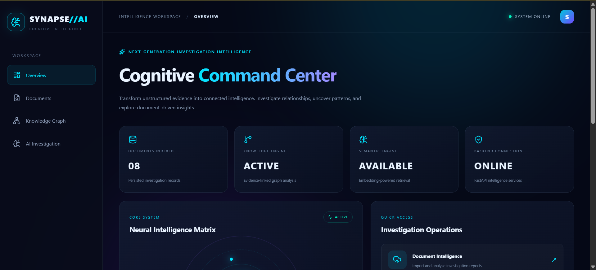
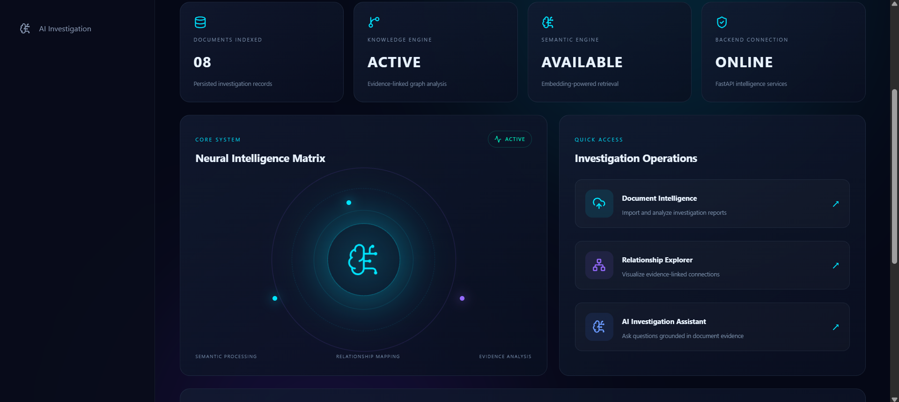
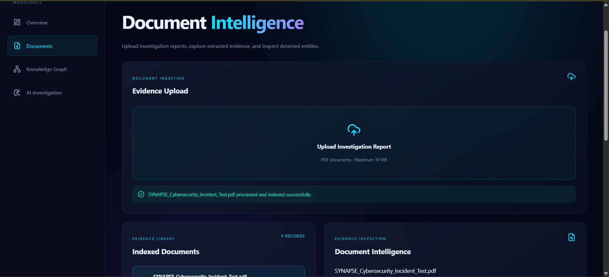
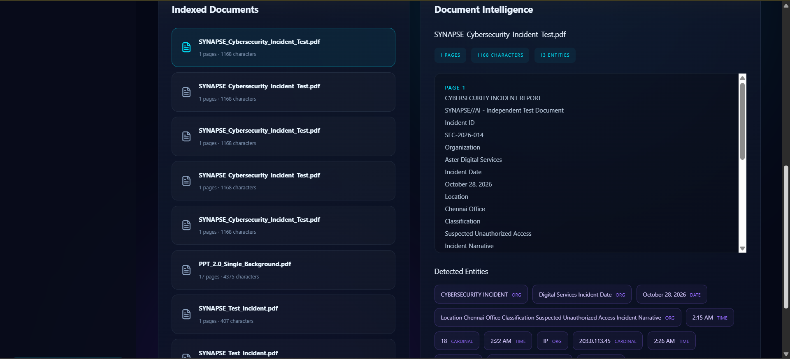
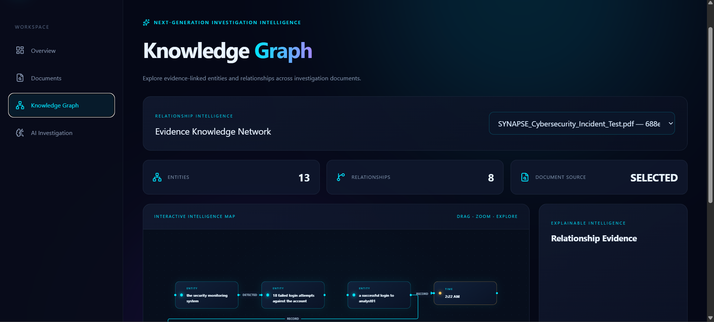
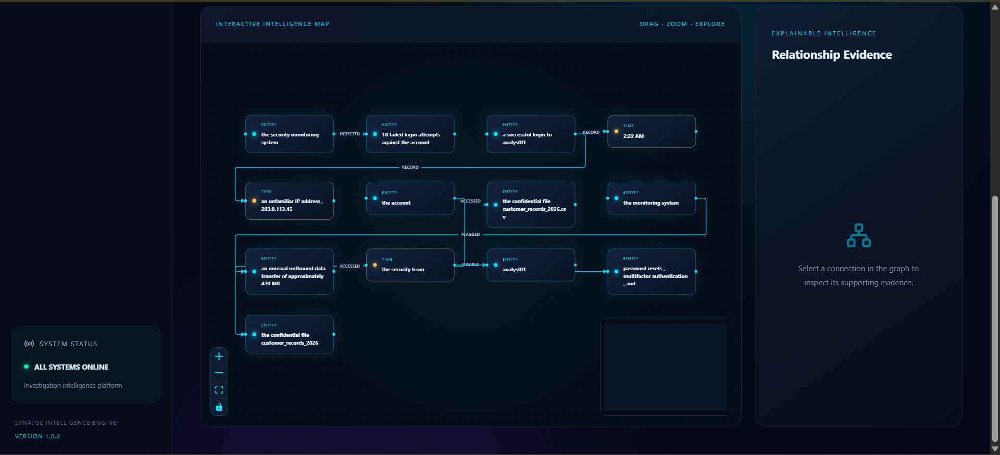
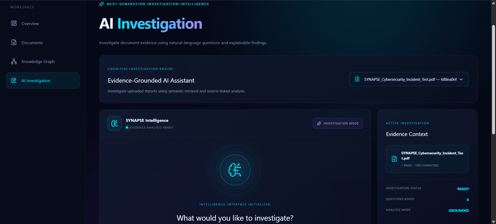
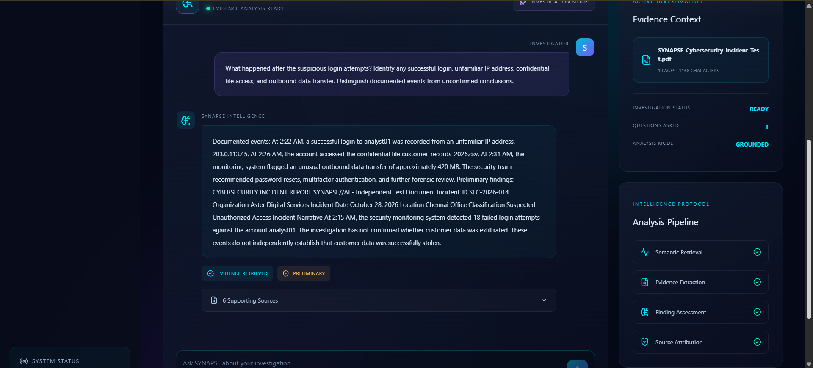
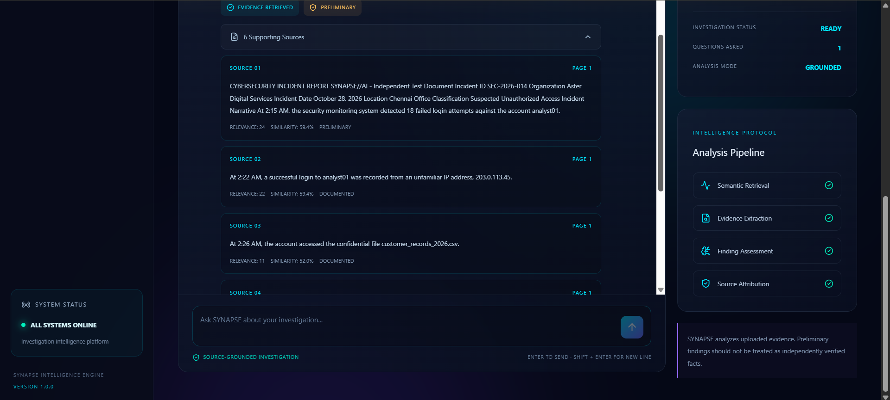
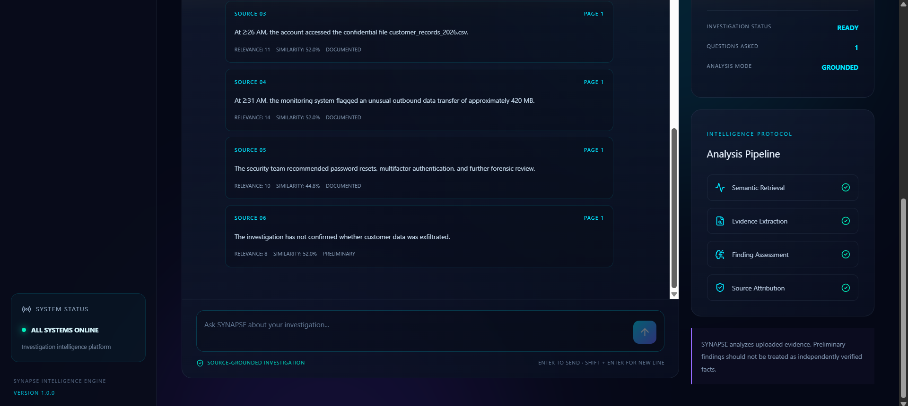

# SYNAPSE//AI

### Explainable Graph-Enhanced AI Investigation Platform

**From fragmented information to connected intelligence.**

SYNAPSE//AI is an AI-powered document intelligence and investigation platform that transforms unstructured PDF documents into searchable evidence, interconnected knowledge graphs, and explainable investigation results.

It combines Natural Language Processing, semantic retrieval, graph-based relationship analysis, and evidence-grounded AI investigation to help users discover connections and understand complex information.

---

## Product Showcase

Explore the SYNAPSE//AI interface and its core intelligence capabilities.

### 1. Cognitive Command Center

### 2. Command Center — Detailed View

### 3. Document Intelligence

### 4. Document Analysis

### 5. Knowledge Graph

### 6. Knowledge Graph — Detailed View

### 7. AI Investigation

### 8. Investigation Evidence

### 9. Investigation Findings

### 10. Complete Platform Overview

---

## Core Features

### 1. Document Intelligence
- PDF document upload and processing.
- Text extraction using PyMuPDF.
- Page-level document analysis.
- Structured document storage.

### 2. Natural Language Processing
- Named Entity Recognition using spaCy.
- Entity identification and normalization.
- Relationship extraction.
- Context-aware information processing.

### 3. Knowledge Graph
- Automatic graph construction from extracted entities and relationships.
- Visual exploration of connected information.
- Interactive graph visualization.
- Relationship-based information discovery.

### 4. Semantic Search
- Natural-language document queries.
- Semantic retrieval of relevant passages.
- Evidence-focused information